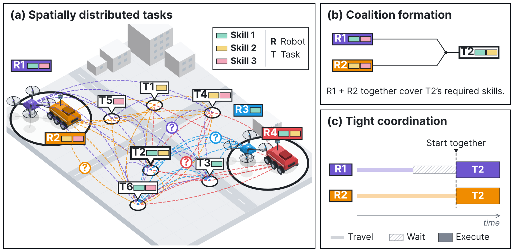
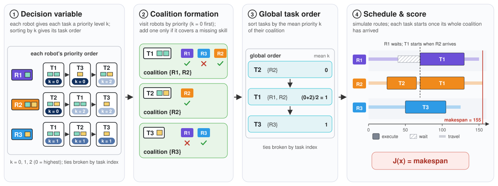
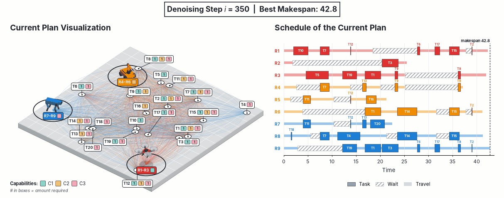
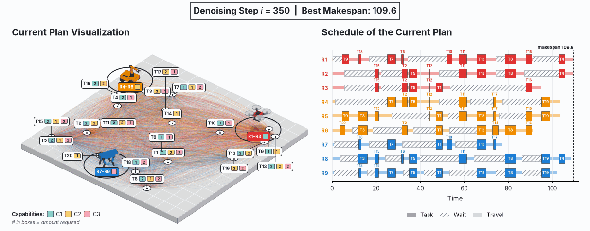
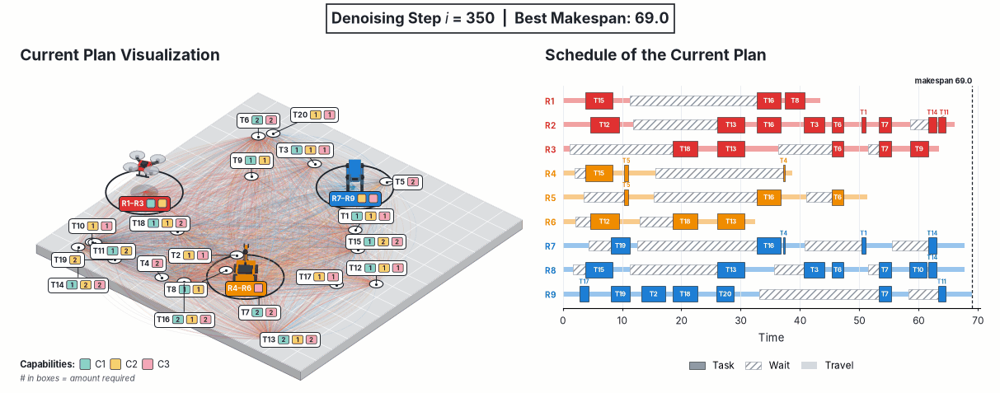

# Discrete Model-Based Diffusion for Multi-Robot Task Allocation

Code for the heterogeneous multi-robot task allocation (MRTA) experiments of our paper
**[Discrete Model-Based Diffusion for Combinatorial Optimization in Multi-Robot Task Allocation](https://arxiv.org/pdf/2611.13382)**.

[📄 Paper](https://arxiv.org/pdf/2611.13382) &nbsp;|&nbsp;
[🌐 Project Page](https://joonlee16.github.io/discrete-mbd.github.io/) &nbsp;|&nbsp;
[💻 Discrete MBD (generic optimization)](https://github.com/joonlee16/discrete-mbd) &nbsp;|&nbsp;
[▶️ Web Demo](https://joonlee16.github.io/playground/discrete-mbd)

## TL;DR

Discrete Model-Based Diffusion (Discrete MBD) is a training-free, sampling-based optimizer that performs denoising
diffusion over discrete decision variables. At every denoising step it samples candidate solutions from
categorical distributions and evaluates them with the cost function, steering the search toward low-cost solutions.

This repository applies it to coalition formation and scheduling for heterogeneous robot teams and benchmarks it
against sampling-based optimizers, an RL policy and CTAS-D. The solver itself lives in the
[Discrete MBD repository](https://github.com/joonlee16/discrete-mbd), included here as a submodule.

## The Problem

<p align="center">
  
</p>

We consider $`R`$ heterogeneous robots and $`T`$ spatially distributed tasks, each requiring a set of capabilities.
A task may need a coalition of robots that must start it together, so coalition formation and scheduling are solved
jointly, and the objective is the makespan (the time at which the last robot returns to its depot).

## Encoding and Decoding

Sampling coalitions and routes directly mostly yields infeasible plans. Instead, each robot assigns each task a
priority level (one categorical variable per robot–task pair), and a deterministic decoder turns any sample into a
feasible plan: robots are added to a task by priority only if they cover a missing capability, tasks are ordered by
their coalition's mean priority, and each task starts once its whole coalition has arrived.

<p align="center">
  
</p>

Every sample is feasible by construction, and the shared task order rules out circular waiting between coalitions.

## Benchmarks and Demos

We use the SA-BT, SA-AT and MA-AT benchmarks from [HeteroMRTA](https://github.com/marmotlab/HeteroMRTA).
In **SA** each robot species has a single capability, while in **MA** a species can have several; in **BT** each task
needs at most one unit of each capability, while in **AT** it can need several.

Each animation shows Discrete MBD solving one instance with 9 robots (3 species, 3 capabilities) and 20 tasks: the
current plan $`\mathbf{x}^{(i)}`$ on the left (faint curves are the candidates sampled at that step), its schedule on
the right, and the best makespan so far at the top as the denoising step goes from $`i = M`$ to $`0`$.
Click an animation for the MP4.

**SA-BT**

<a href="https://joonlee16.github.io/discrete-mbd.github.io/static/videos/denoising_sa_bt.mp4">
  
</a>

**SA-AT**

<a href="https://joonlee16.github.io/discrete-mbd.github.io/static/videos/denoising_sa_at.mp4">
  
</a>

**MA-AT**

<a href="https://joonlee16.github.io/discrete-mbd.github.io/static/videos/denoising_ma_at.mp4">
  
</a>

Across the 15 task-allocation settings, Discrete MBD is the best sampling-based optimizer in 14, and the best method
overall (including RL and CTAS-D) in 8, ranking second in the other 7.

## Repository Structure

```
baseline/
  discrete_mbd_adapter.py    # encoding, decoders and makespan cost for the search methods
  discrete_mbd_history.py    # Discrete MBD with its denoising history recorded (for visualization)
  ctas_d.py                  # CTAS-D baseline wrapper
  rl/                        # RL baseline (HeteroMRTA policy)
env/                         # HeteroMRTA task environment
model/save/                  # released RL policy checkpoint
scripts/
  generate_paper_scenarios.py  # builds PaperScenarioSets/
  run_seed_benchmark.py        # full paper suite (all methods, five seeds)
  make_seed_table.py           # summary table
  setup_external_solvers.sh    # builds CTAS-D
  visualize_denoising.py       # figures and animations of the denoising process
  viz3d.py                     # vector pseudo-3D robot and scene drawing
external/                    # submodules: discrete_mbd, resilient_team_planner (CTAS-D)
```

## Setup

Clone the project with

```bash
git clone --recurse-submodules https://github.com/MarshallVielmetti/dmbd_heterogeneous_coalition_formation.git
cd dmbd_heterogeneous_coalition_formation
```

Use Python 3.10–3.11 and [uv](https://docs.astral.sh/uv/) to install the pinned dependencies:

```bash
uv sync --frozen
```

The full suite requires Linux, a working NVIDIA GPU/driver for the pinned CUDA 12 packages, CMake, a C++ compiler, and Gurobi with a valid license.
Set `GUROBI_HOME` to the Gurobi platform directory, then build CTAS-D and preview the suites:

```bash
export GUROBI_HOME=/path/to/gurobi/linux64
./scripts/setup_external_solvers.sh
uv run --frozen python scripts/run_seed_benchmark.py --dry-run
```

## Reproduce Results

Run the full paper suite

```bash
uv run --frozen python scripts/run_seed_benchmark.py
```

This prepares 15 suites of 50 instances in `PaperScenarioSets/` and runs all eight methods over five seeds, writing per-suite `runs.csv`, plus `summary.csv` and `table.tex` in `results/seed_benchmark/`.
Rerun the same command to resume; use a separate `--output-dir` when changing solver settings or solver sources.

For a small CPU check without Gurobi:

```bash
JAX_PLATFORMS=cpu OMP_NUM_THREADS=1 uv run --frozen python scripts/run_seed_benchmark.py \
  --methods MBD,RL --rl-device cpu --scenarios sa_bt --configurations kn9_ks3_km20_kb3 \
  --limit 1 --seeds 0 --steps 2 --samples 4 --output-dir results/smoke
```

## Visualize the Denoising Process

`scripts/visualize_denoising.py` runs Discrete MBD with the benchmark settings on one instance of
`PaperScenarioSets/` and draws its denoising iterates. The animations above were made with

```bash
uv run --frozen python scripts/visualize_denoising.py --scenario sa_bt --instance 37 --output mp4
uv run --frozen python scripts/visualize_denoising.py --scenario sa_at --instance 41 --output mp4
uv run --frozen python scripts/visualize_denoising.py --scenario ma_at --instance 31 --output mp4
```

By default (`--output all`) it writes a row of paper panels (`.pdf`/`.png`), a large frame of the final plan
(`_final.pdf`/`.png`) and a GIF to `results/figures/`. Choose the panel steps with e.g. `--panels 350,320,150,0` and
the camera with `--azimuth` and `--elevation`; the MBD run is cached, so restyling re-renders in seconds. Run
`python scripts/visualize_denoising.py --help` for all options.

## Acknowledgements

This repository is a fork of [HeteroMRTA](https://github.com/marmotlab/HeteroMRTA), whose environment, benchmarks and
RL policy we build on:

```bibtex
@article{dai2025heterogeneous,
  author  = {Dai, Weiheng and Rai, Utkarsh and Chiun, Jimmy and Cao, Yuhong and Sartoretti, Guillaume},
  journal = {IEEE Robotics and Automation Letters},
  title   = {Heterogeneous Multi-robot Task Allocation and Scheduling via Reinforcement Learning},
  year    = {2025},
  volume  = {10},
  number  = {3},
  pages   = {2654--2661},
  doi     = {10.1109/LRA.2025.3534682}
}
```

## Citation

If you find this work useful, please cite:

```bibtex
@misc{lee2026discrete,
  title         = {Discrete Model-Based Diffusion for Combinatorial Optimization in Multi-Robot Task Allocation},
  author        = {Lee, Haejoon and Vielmetti, Thomas Marshall and Wang, Xinyi and Panagou, Dimitra},
  year          = {2026},
  eprint        = {2611.13382},
  archivePrefix = {arXiv},
  primaryClass  = {cs.RO},
  doi           = {10.48550/arXiv.2611.13382},
  url           = {https://arxiv.org/abs/2611.13382}
}
```
